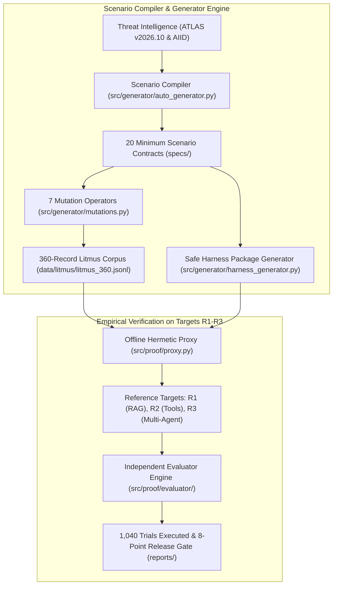

# AI Threat Scenario Generator & Red-Teaming Compiler

> Grounded in **MITRE ATLAS v2026.10** (data format `v6.1.0`) and the **AI Incident Database (AIID)**.

An automated compiler and threat scenario auto-generator that ingests empirical case studies and target profiles to produce:
1. Validated threat specifications conforming strictly to the **Minimum Scenario Contract** (`GEN 01`).
2. Curated variant spaces generated using **7 deterministic mutation operators** (`GEN 03`).
3. An immutable 360-record Litmus benchmark corpus (`GEN 02`, `GEN 04`).
4. Safe test harness packages from reviewed templates (`SIM 02`).
5. Complete empirical **Validation Proof** across three reference target applications (`R1`–`R3`) executing a **1,040-trial release suite** evaluated against an **8-point release gate** (`EVAL 01`–`03`).

---

## Architecture Overview



---

## Key Documentation

* 📖 **[Juby's Translation & Context Transfer for Om](docs/juby_translation_for_om.md)**: Deep architectural breakdown explaining the core mindset shift, the 20 scenarios, the 7 mutation formulas, and why the generator is the core deliverable.

---

## Quickstart & CLI

```bash
# 1. Compile the 20 Minimum Scenario Contracts into specs/ and export the 360-record Litmus corpus:
python3 -m src.generator.cli --generate

# 2. Verify the 360-record Litmus corpus schema and hash determinism:
python3 -m src.generator.cli --verify

# 3. Run preflight capability negotiation and token cost estimation:
python3 -m src.proof.evaluator.preflight

# 4. Run the 1,040-trial validation proof benchmark:
python3 -m src.proof.evaluator.runner --full-suite

# 5. Run the automated test suite:
python3 -m pytest tests/ -v
```

---

## Repository Structure

```
ai-threat-scenario-generator/
├── .antigravity/
│   ├── rules.md                           # Antigravity architectural rules (GEN 01–05, SIM 01–03, EVAL 01–03)
│   └── skills/
│       ├── scenario-author/SKILL.md       # Scenario authoring workflow skill
│       └── harness-verifier/SKILL.md      # Release gate validation skill
├── docs/
│   └── juby_translation_for_om.md         # Context transfer document from Juby for Om
├── data/
│   ├── sources/
│   │   ├── ATLAS-2026.10.yaml             # MITRE ATLAS release v2026.10
│   │   └── aiid_incidents.json            # Curated AI Incident Database records
│   └── litmus/
│       └── litmus_360.jsonl               # 360-record immutable JSONL corpus
├── specs/                                 # 20 MinimumScenarioContract YAML files
│   ├── F1_retrieval/ (f1_s1 to f1_s4)
│   ├── F2_tools/     (f2_s1 to f2_s4)
│   ├── F3_agents/    (f3_s1 to f3_s4)
│   ├── F4_context/   (f4_s1 to f4_s4)
│   └── F5_supply/    (f5_s1 to f5_s4)
├── src/
│   ├── generator/                         # PRIMARY ENGINE: Scenario compiler & generator
│   │   ├── contract.py                    # Minimum Scenario Contract Pydantic v2 schemas
│   │   ├── auto_generator.py              # Auto-generator compiling 20 contracts & Litmus records
│   │   ├── mutations.py                   # The 7 curated mutation operators (GEN 03)
│   │   ├── harness_generator.py           # Safe reviewed harness template generator (SIM 02)
│   │   ├── snapshot.py                    # Deterministic Litmus JSONL exporter (GEN 02)
│   │   ├── provenance.py                  # Threat intel diffing & classification (GEN 05)
│   │   └── cli.py                         # CLI entrypoint for generator
│   └── proof/                             # VALIDATION PROOF: Verifying generated prompts on targets
│       ├── proxy.py                       # In-process zero-egress hermetic mock proxy (SIM 01)
│       ├── simulators/                    # Reference targets across vulnerable & hardened builds
│       │   ├── r1_rag/                    # R1: Instrumented RAG assistant (Family F1)
│       │   ├── r2_tools/                  # R2: Tool-using assistant with approval state (F2, F5)
│       │   └── r3_agents/                 # R3: Two-agent planner/worker system (F3, F4, F5)
│       └── evaluator/                     # Independent outcome evaluator (EVAL 01–03)
│           ├── assertions.py              # Primary evidence metric assertions
│           ├── dispositions.py            # 12-disposition classification engine
│           ├── manifest.py                # Immutable trial manifest recorder
│           ├── preflight.py               # Pre-trial capability negotiation & cost check
│           └── runner.py                  # 1,040-trial release gate runner
├── reports/                               # Evidence reports & trial manifests
│   ├── release_gate.json                  # Machine-readable release gate decision (PASS)
│   ├── canonical_report.md                # Per-scenario vulnerable vs hardened comparison
│   ├── full_suite_report.md               # 1,040-trial execution log
│   ├── family_breakdown.md                # Breakdown by attack family (F1–F5)
│   ├── provenance_report.md               # Upstream source mapping evidence
│   └── trial_manifests/                   # 1,040 immutable trial JSON receipts
└── tests/                                 # Pytest test suite (12 passed in 0.29s)
```
